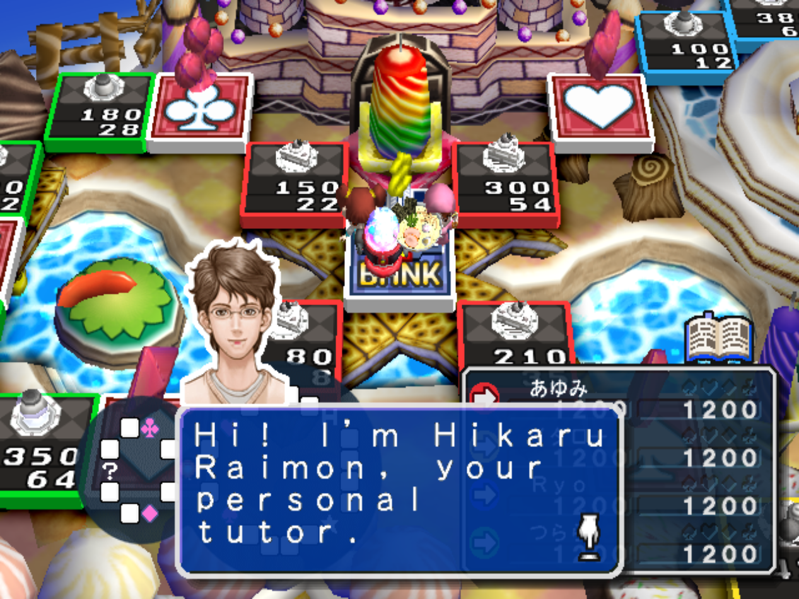
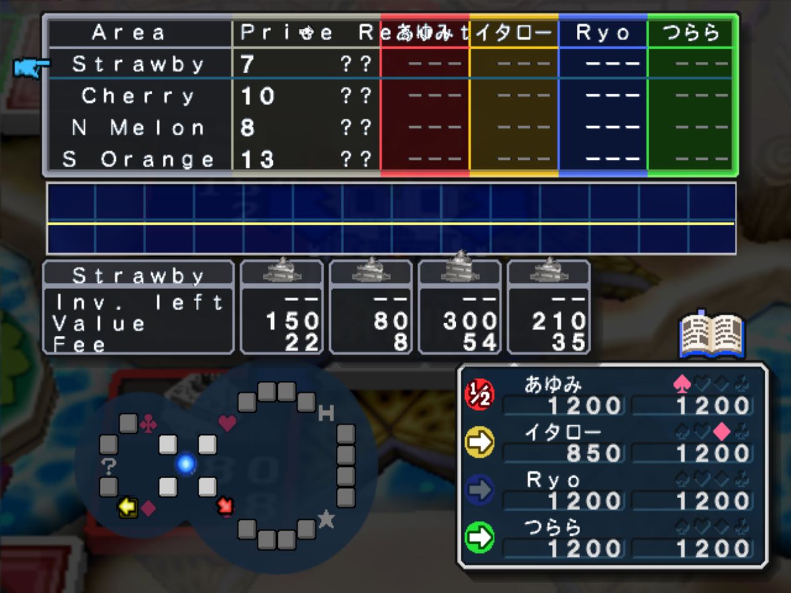
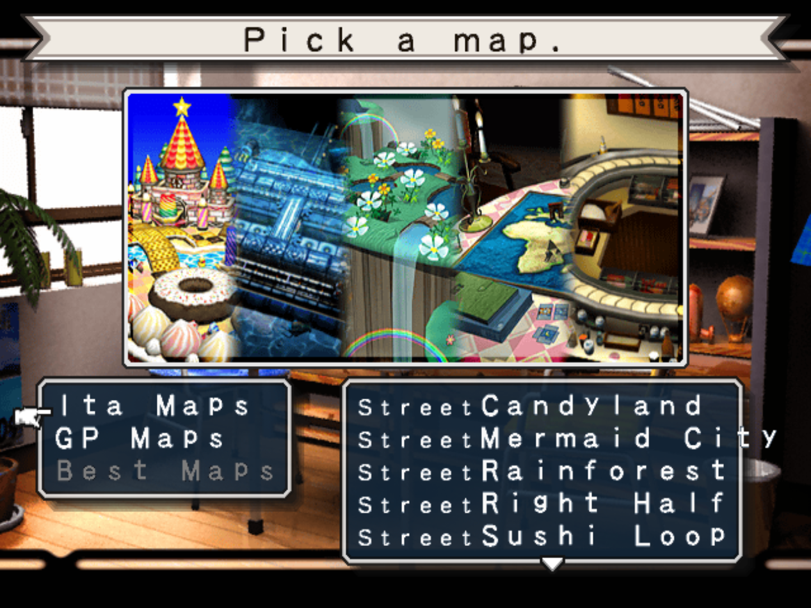
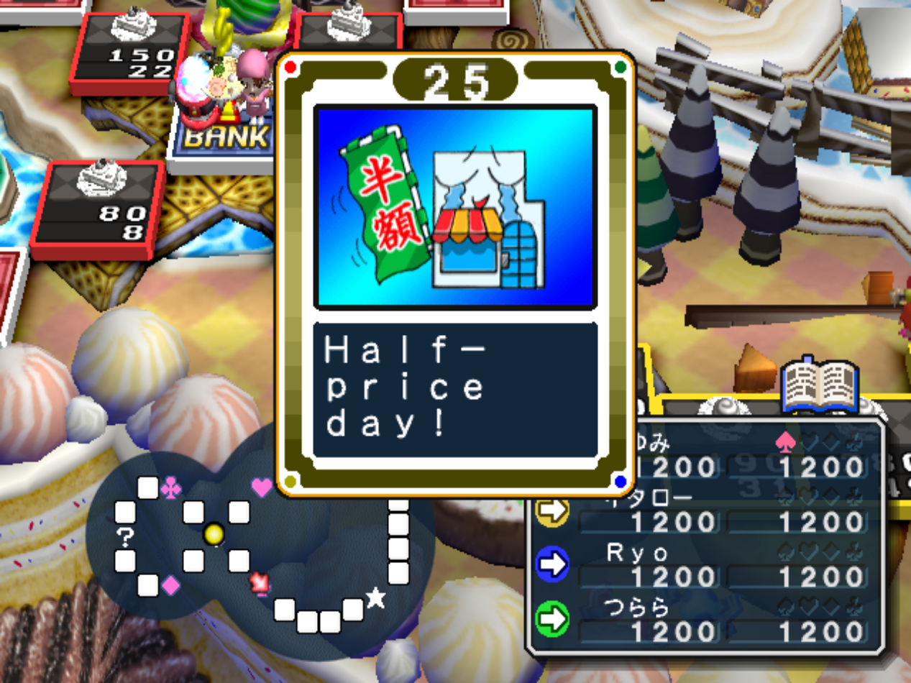

# Itadaki Street 3 — PS2 English Translation

An unofficial, work-in-progress English translation of **Itadaki Street 3: Okuman Chouja ni Shiteageru! Kateikyoushi-tsuki** for PlayStation 2, Japanese release **SLPM-62112**. The edited title screen uses **Fortune Street 3**.

**Current release: v13.** Tested successfully by the project owner with **PCSX2 v2.8.2**. This is a partial translation, not a claim that every mode or dialogue is English.

[Download the v13 patch](https://github.com/ryosama/itadaki-street-3-ps2-english-translation/releases/tag/v13) · [Known limitations](#known-limitations) · [Continue development](docs/DEVELOPMENT.md)

## What's translated

- Main menu and numerous setup, save and gameplay menus.
- Rules explanations and related submenus.
- Most Chance-card summaries and detailed messages; artwork remains Japanese where text is drawn into an illustration.
- Selected male and female Tutor explanations, including introductions and basic gameplay guidance.
- Map names, district names and selected Candyland property names.
- The twelve standard Free Play opponent profiles, their names, descriptions, ages, hometowns, occupations, hobbies and statistics.
- Both title-screen textures, edited by the project owner.

v13 adds **119 string replacements** to v12. The cumulative build preserves **1,064 text allocations**, one font-pitch adjustment, 33 map resources and the two title textures. Allocation counts are not a completion percentage: some strings are shared, and catalog drafts are not necessarily integrated.

## Apply the patch on Windows

1. Obtain your own original Japanese **SLPM-62112** ISO and check its hash against the table below. No game download is supplied here.
2. Download the v13 release and extract its ZIP.
3. Download [Floating IPS (Flips)](https://github.com/Sir-Walrus/Flips), which supports BPS patches.
4. In Flips, choose **Apply Patch**, select `Itadaki_Street_3_English_v13.bps`, then select your **original, unpatched ISO**.
5. Save to a **new** file, for example `Itadaki_Street_3_English_v13.iso`. Never overwrite the original.
6. Boot the new ISO in PCSX2. Do not load an older savestate to test changed strings; start a fresh boot. Normal memory-card saves can be used, but already-stored character names may remain Japanese.

The patch is **cumulative**. Apply it directly to the original ISO, **not** to a v11/v12 ISO or another modified image. A filename match is not sufficient: the original checksum must match. No custom `Apply*` launcher is needed; use Flips.

## ISO checksums

Both ISO images are **575,420,416 bytes**.

| Image | SHA256 | CRC32 |
| --- | --- | --- |
| Original Japanese ISO | `6e8e471f9b6aef1af78b9cf99407ffd9adaa2c51a871f622dd84db140404dcab` | `0c2d5525` |
| English v13 ISO | `742a75cda5279e2ca8a460e28d001c0460e1ed20e9dec976f582d46fb9377403` | `fbf40d28` |

BPS SHA256: `f485955a9257b69fa9e303787227b443bc0773aeb046662298836bfdeb1d442d` (364,799 bytes).

To check SHA256 on Windows:

```powershell
Get-FileHash -Algorithm SHA256 -LiteralPath 'C:\path\to\your.iso'
```

## Screenshots

Owner-provided screenshots illustrate the translated features. Some show earlier builds or Japanese names already stored in a save; they are not evidence of complete translation.

### Title screen


### Main menu


### Tutor Mode



### In-game play / Free Play interface



### Map selection



### Chance cards



## Known limitations

- Most Tutor dialogue is still Japanese: 149 of 1,825 identified non-null Tutor pages were translated in phases 9–10. The similarly styled player-identification prompt added in v13 is a separate menu string.
- Many character dialogues, property names, Training/Quest screens and other messages remain untranslated. Historical catalogs include rejected or unintegrated drafts.
- Some graphic labels remain Japanese, including the red participation badge in opponent selection, card illustrations and title-screen credits.
- Small fixed text allocations require abbreviations. In opponent profiles, `W/R` means win ratio and `Like` means hobby. More complete meanings are preserved in the phase 13 report.
- Owner testing is encouraging, but is not exhaustive testing of every map, mode, event or opponent. Hardware compatibility has not been verified.

Please report untranslated text, clipping or errors with the patch version, mode, map and a screenshot. Do not attach ISO files, BIOS, memory cards or savestates to issues.

## For contributors

The repository includes source tools, translation catalogs, technical reports, a sanitized phase history, the two approved English title PNGs and the v13 BPS. It does **not** include original or patched game binaries, ISO images, BIOS or emulator data.

Start with [the development guide](docs/DEVELOPMENT.md), [current project state](docs/PROJECT_STATE.md), [technical reference](docs/TECHNICAL_REFERENCE.md) and [the resumption prompt](docs/RESUME_PROMPT.md). Codex instructions are in [AGENTS.md](AGENTS.md), following the [AGENTS.md convention](https://developers.openai.com/codex/guides/agents-md/).

With Python 3.12+ and your original ISO, the standalone builder reproduces the **byte-identical published v13 BPS**, without historical intermediate files or third-party Python packages:

```powershell
python -X utf8 tools/build_current.py --iso 'C:\path\to\original.iso'
```

Private extracted originals and patched resource copies are written only to ignored `work/`; **no ISO is written**. See the development guide before editing recipes or running historical scripts.

## Credits and project status

Project owner, edited title artwork, screenshots and runtime testing: **ryosama**. Reverse engineering, translation drafts, tooling and documentation were developed collaboratively with **OpenAI Codex**; human review and testing remain important.

This is an independent fan project, not an official localization. No license has been selected for the project, and no LICENSE file is provided.
